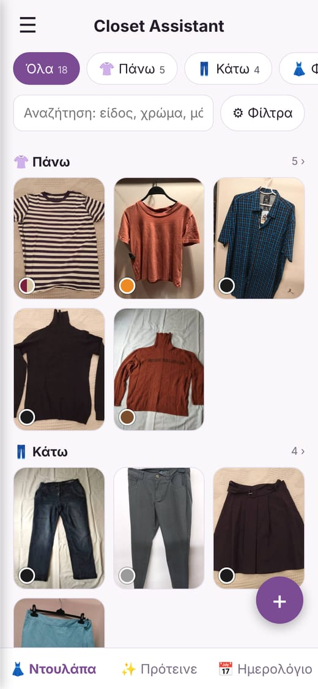
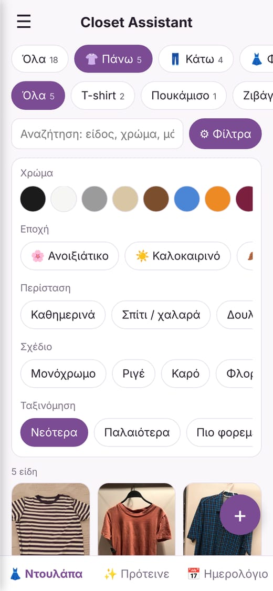
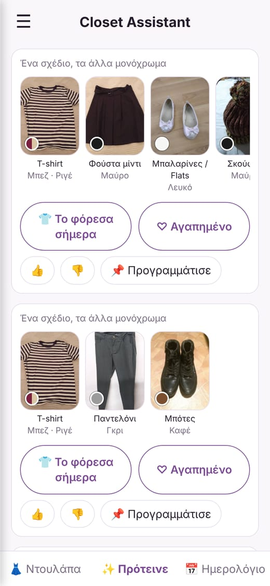
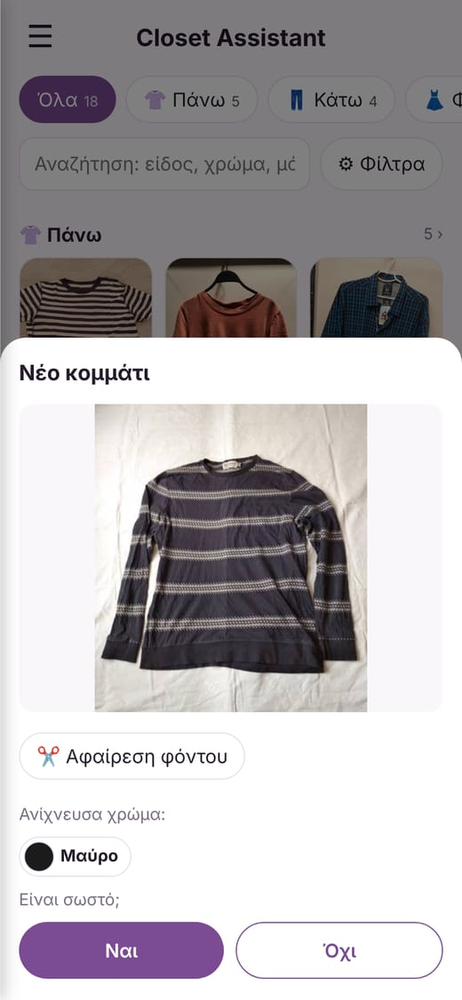
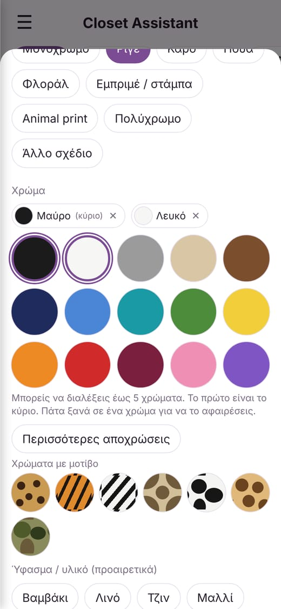
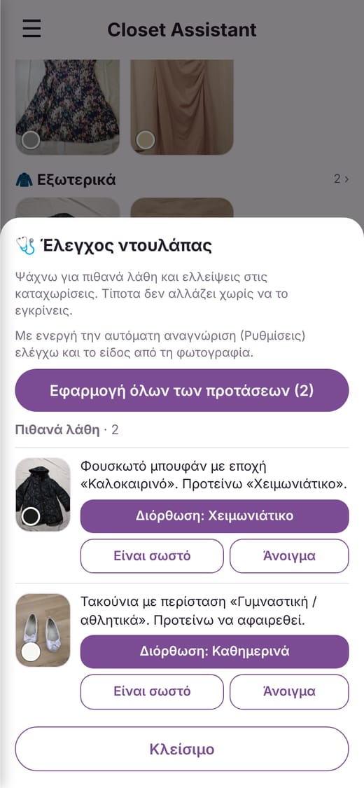

# Closet Assistant

Ψηφιακή ντουλάπα και προτάσεις ντυσίματος σε ένα μόνο αρχείο HTML (`index.html`), χωρίς server και χωρίς λογαριασμό. Η εφαρμογή είναι στα ελληνικά και στα αγγλικά και έχει σκοτεινή εμφάνιση.

*Οι φωτογραφίες ρούχων στις εικόνες είναι από το [Clothing dataset](https://github.com/alexeygrigorev/clothing-dataset) (CC0).*

## Τι κάνει

**Ντουλάπα**
- Προσθήκη ρούχων, παπουτσιών και αξεσουάρ με φωτογραφία (κάμερα ή συλλογή, μία ή πολλές μαζί).
- Ξεχωριστές ομάδες για πάνω, κάτω, φορέματα και ολόσωμες, εξωτερικά, παπούτσια και αξεσουάρ, με υποκατηγορίες: T-shirt, μακρυμάνικο, τοπάκι, crop top, μπουστάκι, κορμάκι, μπλούζα, πουκάμισο, polo, πουλόβερ, ζιβάγκο, φούτερ crewneck, φούτερ με κουκούλα, αθλητικό τοπ, τζιν, παντελόνι, φόρμα, σορτς, φούστα κοντή/μίντι/μακριά, κολάν, φόρεμα κοντό/μίντι/μακρύ, ολόσωμη, σαλοπέτα, τζάκετ, παλτό, καμπαρντίνα, φουσκωτό μπουφάν, σακάκι, ζακέτα, γιλέκο, αδιάβροχο, 9 είδη παπουτσιών, 6 είδη τσάντας και 4 είδη καπέλου.
- Σχέδιο (μονόχρωμο, ριγέ, καρό, πουά, φλοράλ, εμπριμέ, animal print, πολύχρωμο) και έως 5 χρώματα για κομμάτια με σχέδιο.
- Περιστάσεις: καθημερινά, σπίτι, δουλειά, έξοδος, επίσημο, γυμναστική, εκδρομή, παραλία.
- Εποχές: ανοιξιάτικο, καλοκαιρινό, φθινοπωρινό, χειμωνιάτικο (ένα κομμάτι μπορεί να έχει πολλές).
- Ύφασμα, μάρκα και τιμή αγοράς (τα δύο τελευταία ανοίγουν μόνο αν τα χρειαστείς).
- Γρήγορη πλοήγηση: ομάδες με αριθμό κομματιών, υποκατηγορίες, φίλτρα χρώματος, εποχής, περίστασης και σχεδίου, ταξινόμηση, αναζήτηση.
- Έλεγχος διπλότυπων με επιλογή «Δεν είναι το ίδιο»: η εφαρμογή το θυμάται και γίνεται λιγότερο αυστηρή στα επόμενα.
- **Έλεγχος ντουλάπας** (από το μενού): βρίσκει πιθανά λάθη και ελλείψεις (π.χ. φουσκωτό μπουφάν σημειωμένο για καλοκαίρι, τακούνια για γυμναστική, χρώμα που δεν ταιριάζει με τη φωτογραφία, λάθος είδος, διπλότυπα, κομμάτια χωρίς εποχή ή περίσταση) και προτείνει διόρθωση. Τίποτα δεν αλλάζει χωρίς έγκριση. Το «Είναι σωστό» το θυμάται.

**Αναγνώριση από τη φωτογραφία**
- **Χρώματα:** αφαιρεί το φόντο, βρίσκει τα χρώματα του κομματιού και προτείνει πόσα είναι (έως 5). Το όνομα κάθε χρώματος το αποφασίζουν η παλέτα, παραδείγματα από φωτογραφίες με ετικέτες και οι δικές σου διορθώσεις.
- **Είδος, υποκατηγορία, σχέδιο, ύφασμα** (προαιρετικό, από τις Ρυθμίσεις): τρέχει στη συσκευή σου. Συμπληρώνει αυτόματα σχέδιο, ύφασμα, περιστάσεις και εποχές με αστεράκι ✨ ώστε να ελέγξεις και να διορθώσεις.
- Ό,τι αποθηκεύεις ή διορθώνεις (είδος, χρώμα, σχέδιο, ύφασμα, περιστάσεις, εποχή) το θυμάται και βελτιώνεται στα επόμενα.

**Προτάσεις**
- Συνδυασμοί με βάση περίσταση, διάθεση (άνετο, κομψό, έντονο) και, προαιρετικά, ένα κομμάτι που θέλεις να φορέσεις.
- Καιρός από την τοποθεσία που διαλέγεις (σήμερα ή αύριο). Χωρίς τοποθεσία, η εποχή βγαίνει από το ημερολόγιο.
- Αξιολόγηση χρωμάτων και μοτίβων, και αποφυγή όσων φόρεσες πρόσφατα.
- Βαθμολόγηση 👍/👎, αγαπημένοι συνδυασμοί και προγραμματισμός για μελλοντική μέρα.

**Ημερολόγιο και στατιστικά**
- Καταγραφή «Το φόρεσα σήμερα», ημερολόγιο ντυσίματος, στατιστικά χρήσης και κόστος ανά φορά.
- Λίστα για βαλίτσα ανά ημέρες, περιστάσεις και καιρό.

**Αντίγραφο ασφαλείας**
- Εξαγωγή και εισαγωγή αρχείου JSON, μαζί με αγαπημένα, βαθμολογίες, προγραμματισμένα ντυσίματα και ό,τι έχει μάθει η εφαρμογή. Τα παλιά αντίγραφα διαβάζονται κανονικά.

## Ακρίβεια (μετρημένη)

Μετρήθηκε σε φωτογραφίες που η εφαρμογή δεν είδε κατά την εκπαίδευση (cross-validation), εκτός αν σημειώνεται αλλιώς:

| Τι | Αποτέλεσμα |
|---|---|
| Κύριο χρώμα, 20 δείγματα φωτογραφιών | 18/20 (πριν: 15/20) |
| Υποκατηγορία πάνω μέρους (9 ομάδες) | 73% πρώτη επιλογή, 93% μέσα στις 3 που προτείνει |
| Υποκατηγορία εξωτερικού / κάτω μέρους | 82% / 94% πρώτη επιλογή |
| Σχέδιο, όταν το προτείνει | σωστό στο 88%, βρίσκει περίπου τα μισά σχέδια |
| Ύφασμα τζιν / πλεκτό, όταν το προτείνει | σωστό στο 75% / 73% |

Η αναγνώριση κάνει λάθη. Γι' αυτό ρωτά ή σημειώνει ό,τι συμπλήρωσε μόνη της, και μαθαίνει από τις διορθώσεις.

## Δεδομένα και ιδιωτικότητα

- Τα δεδομένα αποθηκεύονται μόνο στη συσκευή (IndexedDB και localStorage του browser). Αν καθαρίσεις τα δεδομένα του browser, χάνονται. Κάνε εξαγωγή αντιγράφου κατά διαστήματα.
- Οι ενημερώσεις του αρχείου δεν σβήνουν τα δεδομένα, εφόσον η εφαρμογή ανοίγει από την ίδια διεύθυνση.
- Οι φωτογραφίες δεν ανεβαίνουν πουθενά. Η εφαρμογή κρατά για κάθε κομμάτι μόνο έναν μικρό αριθμητικό «χαρακτηρισμό» της φωτογραφίας (embedding) για τη μάθηση.

## Εξωτερικές κλήσεις

- **Καιρός:** Open-Meteo (αναζήτηση πόλης και πρόγνωση), μόνο όταν επιλέξεις τοποθεσία.
- **Αναγνώριση είδους (προαιρετική, απενεργοποιημένη από προεπιλογή):** φορτώνει τη βιβλιοθήκη Transformers.js από το jsDelivr και το οπτικό μέρος του μοντέλου `Xenova/clip-vit-base-patch32` (περίπου 90 MB, μία φορά). Μετά τρέχει τοπικά.
- **Αφαίρεση φόντου (προαιρετική):** μοντέλο `briaai/RMBG-1.4` (περίπου 45 MB, μία φορά) μέσω της ίδιας βιβλιοθήκης. Μετά τρέχει τοπικά. Η άδεια του μοντέλου (`bria-rmbg-1.4`) επιτρέπει μη εμπορική χρήση. Για εμπορική χρήση απαιτείται συμφωνία με την BRIA.

## Χρήση

Άνοιξε το `index.html` σε browser, ή φιλοξένησέ το σε οποιονδήποτε στατικό server. Το GitHub Pages σε private repo απαιτεί πληρωμένο πλάνο του GitHub.

Για ανάπτυξη και επανεκπαίδευση της αναγνώρισης: [docs/DEVELOPMENT.md](docs/DEVELOPMENT.md).

## Δεδομένα εκπαίδευσης

Η αναγνώριση εκπαιδεύτηκε με φωτογραφίες ελεύθερης άδειας. Στην εφαρμογή περιλαμβάνονται μόνο αριθμοί που προκύπτουν από αυτές (βάρη ταξινομητών και παραδείγματα χρωμάτων), όχι οι φωτογραφίες:

- F. Nauman, *Clothing Dataset for Second-Hand Fashion*, Zenodo, [doi:10.5281/zenodo.8386668](https://doi.org/10.5281/zenodo.8386668), άδεια [CC BY 4.0](https://creativecommons.org/licenses/by/4.0/). Χρησιμοποιήθηκαν οι μπροστινές φωτογραφίες και οι ετικέτες τύπου, σχεδίου και χρώματος, μετά από αποκοπή του ρούχου.
- A. Grigorev, [Clothing dataset](https://github.com/alexeygrigorev/clothing-dataset), άδεια CC0.

## Σημείωση για εμπορική χρήση

Το μοντέλο αφαίρεσης φόντου (`briaai/RMBG-1.4`) επιτρέπει μόνο μη εμπορική χρήση. Αν η εφαρμογή γίνει εμπορική, πρέπει να αντικατασταθεί με μοντέλο με ελεύθερη άδεια ή να γίνει συμφωνία με την BRIA. Τα δεδομένα εκπαίδευσης (CC BY 4.0 και CC0) επιτρέπουν εμπορική χρήση με αναφορά της πηγής, όπως παραπάνω.
